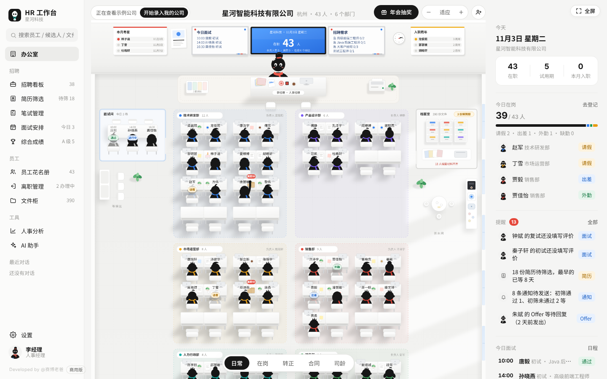
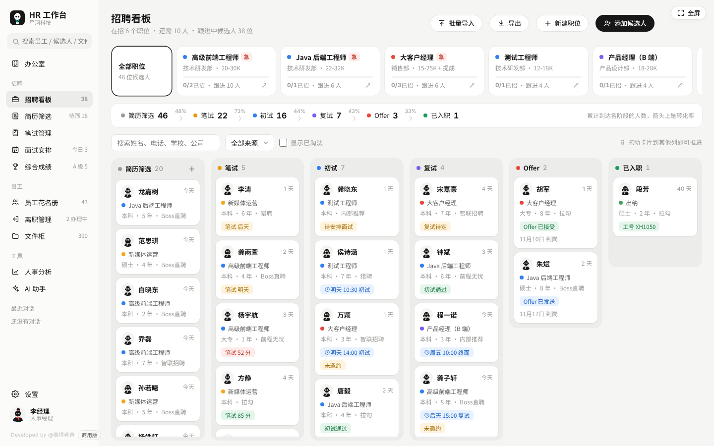
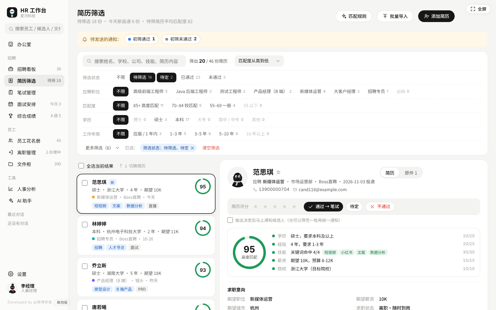
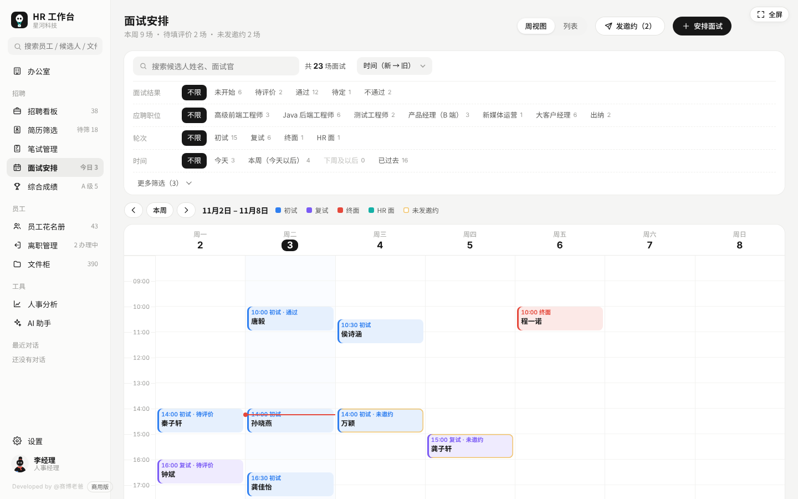
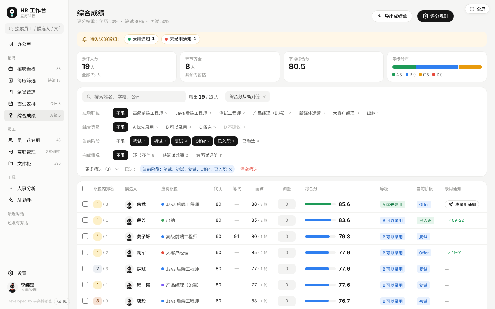
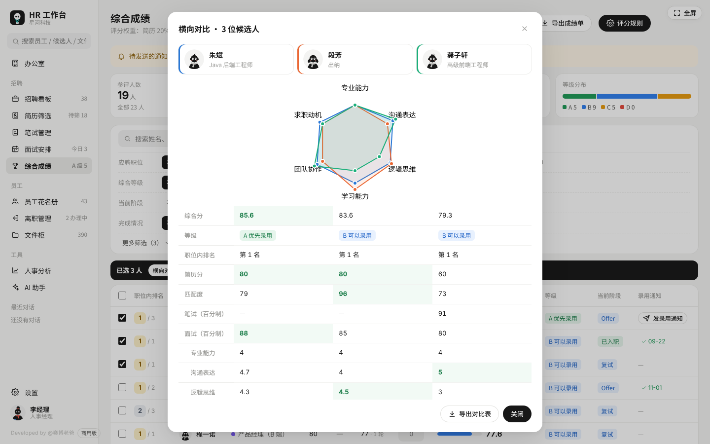
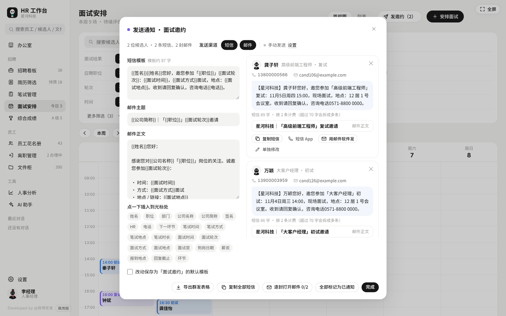
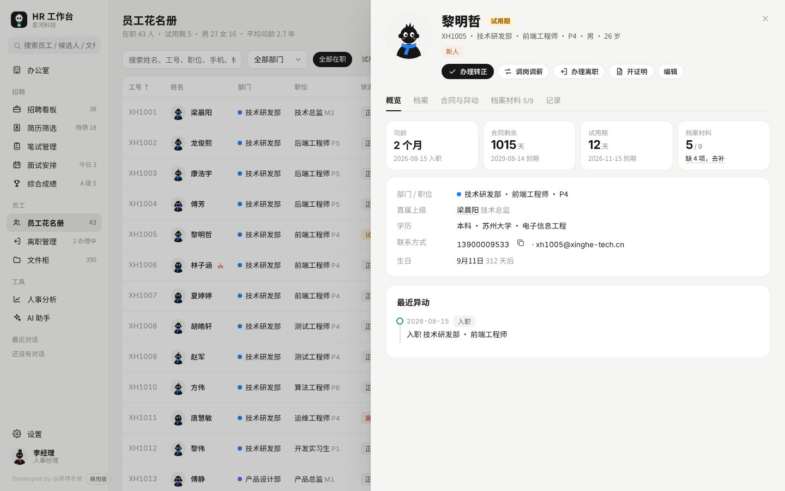
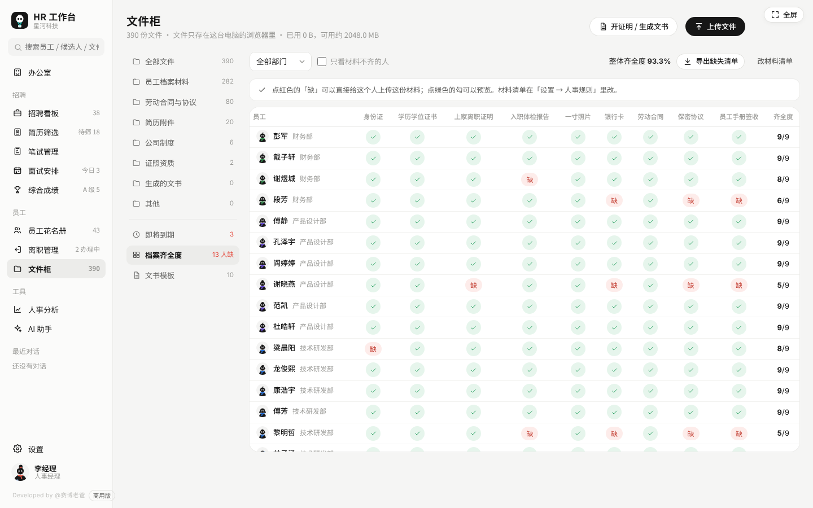
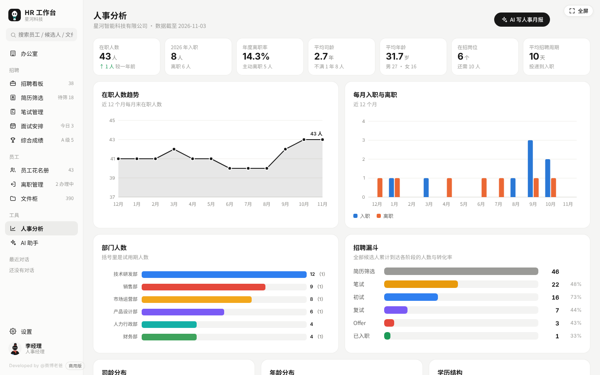

<div align="center">

# HR 工作台

**一个网页文件就能用的人事工作台**

招聘、笔试、面试、综合评分、员工档案、离职、文件和证明，一个人就能把公司的人事管起来。

基础功能无需安装、注册或部署服务器，双击 `index.html` 即可使用。业务数据默认保存在本机浏览器；AI 与自动通知为可选联网功能。

   

[下载与开始使用](#快速开始) · [详细使用说明](使用说明.md) · [使用许可](LICENSE)

「个人工作台」系列 · Developed by @赛博老爸

</div>



---

## 这是什么

很多小公司没有 HR 系统，人事靠 Excel 加微信。员工信息散落各处，合同什么时候到期全靠记，候选人面到哪一轮要翻聊天记录，开个在职证明还要翻模板改半天。

HR 工作台把这些事放进一个页面：

- 打开就是一间**办公室**：每个部门一块工位区，谁请假、谁在试用期、谁合同快到期、谁今天过生日，一眼看到
- 招聘从**登记候选人到入职**全流程：简历筛选、笔试、面试、综合评分、Offer；支持生成短信 / 邮件通知，配置通知服务后可直接发送
- 员工从**入职到离职**全周期：档案、转正、调岗、续签、交接、离职证明
- 证明和通知书**自动生成**：录用通知书、在职证明、收入证明、离职证明……信息自动带入，可以导出 Word、直接打印

**适合**：一个人负责日常人事的行政 / HR、创业公司负责人。当前仓库是 PC 本地版，没有多人权限、实时协作或自动云同步。个人使用及商业授权边界见 [LICENSE](LICENSE)。

## 截图

| 招聘看板 | 简历筛选 |
|---|---|
|  |  |
| **面试安排** | **综合成绩** |
|  |  |
| **候选人横向对比** | **一键通知** |
|  |  |
| **员工档案** | **档案齐全度** |
|  |  |

**人事分析**



## 功能一览

### 办公室
- 按部门自动排工位，部门越多办公室越大，人员颜色就是部门颜色
- 五种视角切换：**日常 / 在岗 / 转正 / 合同 / 司龄**，在岗模式下点一下员工就能登记请假、出差、外勤
- 面试间里坐着今天来面试的候选人，档案室显示快到期的文件和材料不齐的人数
- 右侧提醒中心：试用期到期、合同到期、离职交接、面试待评价、Offer 待回复、简历待筛选、通知待发送
- 生日和入职周年提醒，一键生成祝福语
- **年会抽奖**：按部门抽、可排除已中奖、导出中奖名单

### 招聘
- **招聘看板**：职位管理、候选人看板，拖动卡片推进阶段，招聘漏斗和转化率一目了然
- **简历筛选**：
  - 每份简历自动算**匹配度**（学历、经验、技能关键词、期望薪资、院校逐项对照）
  - 12 个维度**横向筛选**：状态、职位、匹配度、学历、年限、薪资、技能、院校、渠道、投递时间、求职状态、标签
  - 简历预览 + 原件（PDF / 图片）预览，星级评分、筛选备注
  - 通过 / 待定 / 不通过，支持批量操作，键盘 ↑ ↓ 快速切换
- **笔试管理**：试卷题库（单选、多选、判断、填空、简答、编程），打印试卷和答案版，粘贴导入题目，从 Excel 整列粘贴分数，全部考生横向筛选
- **面试安排**：周历 / 列表两种视图，面试官时间冲突提醒，按维度打分的面试评价表，未发邀约的面试会标出来
- **综合成绩**：
  - 简历分、笔试、面试按权重算综合分，权重可以按职位单独设置
  - 自动给出 **A 优先录用 / B 可以录用 / C 备选 / D 不建议** 等级和职位内排名
  - 支持 ±10 分人工调整（背调、作品等），环节没走完的显示为「暂估」不参与排名
  - 勾选 2–4 人**横向对比**：雷达图 + 逐项对比，最好的一项标绿
- **一键通知**：初筛通过、初筛未通过、笔试邀约、面试邀约、录用通知、未录用通知
  - 短信和邮件模板自动带入姓名、职位、时间、地点，模板可以自己改
  - 每个人通知过没有都有记录，改了面试时间会提示重新通知
  - 手动发送（复制 / 短信 App / 邮件软件 / 导出群发表格）或通知接口自动发送

### 员工
- **员工花名册**：按部门、状态、合同到期、生日、材料齐全度筛选，从 Excel 一次导入
- **员工档案**：基本信息、任职信息、劳动合同、异动记录、档案材料、谈话奖惩记录；身份证号和薪资默认隐藏
- **入职**：入职清单自动生成，从候选人一键办理入职，信息自动带入
- **在职**：转正、调岗、晋升、调薪、续签合同（第 3 次签订会提示无固定期限合同的规定）
- **离职管理**：发起离职、交接清单、离职面谈、离职证明；离职率、离职原因、离职时司龄分析

### 文件
- **文件柜**：拖拽上传，按员工档案、合同、简历、制度、证照分类，PDF 和图片直接预览，设置到期提醒
- **档案齐全度**：一张表看清每个人缺哪份材料，点「缺」直接上传
- **文书模板**：录用通知书、面试邀请函、感谢信、转正通知书、调岗通知书、在职证明、收入证明、离职证明、续签意向书、员工手册签收单，可以自己新建模板

### 分析与 AI
- **人事分析**：在职人数趋势、每月入离职、部门结构、司龄 / 年龄 / 学历分布、招聘漏斗、渠道效果、职位招聘进度
- **AI 助手（可选）**：简历评估、写 JD、面试题、笔试出题（可一键导入试卷）、评价汇总、Offer 沟通、婉拒信、转正评估、员工面谈、离职面谈、员工关怀、全员通知、制度起草、用工问答、人事月报、招聘复盘

## 快速开始

1. 打开 [workstation-HR 仓库](https://github.com/cyberdaddyleo/workstation-HR)，点击文件列表上方的 **Code → Download ZIP** 下载源码包。
2. **先解压整个文件夹**，放到以后固定使用的位置。找到 `index.html`，右键选择用电脑上的 **Chrome** 或 **Edge** 打开；无需安装依赖，也无需启动下面的可选服务。
3. 第一次打开时选择形象和使用方式：
   - **先看看示例公司**：带四十多名虚拟员工、职位和候选人，方便体验。
   - **直接用我的公司**：选择互联网 / 制造业 / 零售连锁 / 通用部门模板，从空办公室开始。
4. 到「设置 → 公司信息、部门与职级、人事规则」填写公司资料；已有花名册可在「员工花名册 → 批量导入」中粘贴带表头的 Excel 区域，或导入 CSV。
5. 完成首次录入后，到「设置 → 数据与备份」下载一份备份。有真实附件时选择「导出完整备份」。

熟悉 Git 的用户也可以：

```bash
git clone https://github.com/cyberdaddyleo/workstation-HR.git
```

建议固定使用同一浏览器、同一浏览器用户和同一文件路径。更换路径、浏览器或电脑前先备份，数据不会跟着 `index.html` 自动迁移。详细操作见 [使用说明](使用说明.md)。

## 一键发短信 / 邮件

在「设置 → 短信 / 邮件通知」里选发送方式：

**手动发送（默认，无需通知服务）**
- 短信：一键复制，或者用手机 / 电脑上的短信应用直接打开
- 邮件：用电脑上的邮件软件打开，收件人、主题、正文都已填好
- 人多时：导出群发表格，导入短信平台群发

复制短信、打开短信 App / 邮件软件后，仍需在对应应用里完成发送；工作台中的手动通知记录不等于送达回执。

**通知接口自动发送（可选）**

网页本身不能直接发短信和邮件，仓库里的 `notify-server.js` 会在你电脑上帮它转发，不需要安装任何依赖：

```bash
# 在已安装 Node.js 的电脑上，进入解压后的工作台目录运行
node notify-server.js
```

首次运行会生成 `notify-config.json` 并退出。按需填写配置、启用对应渠道，再执行同一命令并保持终端窗口打开。

- **邮件**：通过 SMTP 发送，支持 465 端口直接 TLS，或服务端支持时的 STARTTLS；填写服务商提供的 SMTP 地址、账号和**授权码**，将 `email.enabled` 设为 `true`
- **短信**：使用阿里云短信服务。国内短信必须先审核通过**签名**和**模板**，再把每种通知对应的模板 Code 填进配置，将 `sms.enabled` 设为 `true`。模板变量名请用 `name`、`job`、`company`、`time`、`place`、`mode`、`round`、`date`、`phone`
- 先演练：把 `dryRun` 改成 `true`，在设置页向自己的测试手机号 / 邮箱测试。演练仍需启用渠道；短信还需填写模板 Code。确认配置后改回 `false` 并重启服务，才会实际发送

然后在工作台设置里选「通知接口自动发送」，地址填 `http://127.0.0.1:8790/send`；建议启用真实账号时设置 `token`，并在「接口口令」填写同一值。填自己的测试手机号 / 邮箱，点「发一条测试」。通知服务只监听本机，真实发送会连接邮件或短信服务商。

演练模式也会向网页返回成功，候选人通知窗口可能记成「已发送」，因此请先用设置页测试，不要用真实候选人通知记录代替演练记录。具体配置和排错见 [使用说明](使用说明.md)。

> ⚠️ `notify-config.json` 里有邮箱授权码和短信密钥，**不要上传到网上**。仓库自带的 `.gitignore` 已经把它排除了。

## AI 助手（可选）

不配置 AI 也能用其他全部功能。

- **不配置**：点生成时会给你一段整理好的提示词，复制到豆包、DeepSeek、Kimi、通义等任意 AI 网页版粘贴即可
- **配置接口**：在「设置 → AI 接口」选服务商，填写接口地址、可用模型名称和 API Key，再测试连接。内置 DeepSeek、通义千问、Kimi、智谱、豆包、硅基流动、OpenAI、Claude、Ollama 与 OpenAI 兼容接口选项；实际可用模型以自己的服务商账户为准
- **姓名替换**：可在设置里启用发送前将已登记员工、候选人姓名替换成「【员工07】」这样的编号，接口回复后还原。它不是完整的隐私过滤器：职位薪资、期望薪资、Offer、备注、评语和手动输入都可能进入提示词，请先核对内容
- 提示「连不上」时，可以用仓库里的 `ai-proxy.js` 在本机中转（见 [使用说明](使用说明.md)）；中转仍会把请求和 API Key 转发到所配置的 AI 服务商
- 在工作台调用云端 AI，或手动把提示词粘贴到 AI 网页版，均会将相应内容交给该服务商处理。使用本机 Ollama 时，请确认配置的是自己的本地服务

## 数据、备份与隐私

- **本地保存**：基础业务记录写入当前浏览器的 localStorage，附件写入 IndexedDB。文件夹里的 `index.html` 是程序，不是业务数据备份；当前版本没有自动云同步。
- **联网边界**：启用云端 AI 后会发送提示词和相关业务上下文；使用通知接口会发送收件人、通知内容和模板变量。API Key 会用于向所选 AI 服务鉴权。
- **定期备份**：在「设置 → 数据与备份」选择「导出备份（不含文件）」或「导出完整备份（含 N 个文件）」。有附件时使用完整备份，并核对下载成功及实际打包文件数。
- **恢复**：先备份当前数据，再选择「从备份恢复」并导入 JSON；确认后会覆盖当前业务数据。普通备份不能恢复缺失的附件本体。恢复完成后核对员工、候选人和附件是否可用。
- **升级**：先完整备份并保留旧版本，在原路径替换程序文件，用同一浏览器打开并核对数据；若打开的是新路径或新浏览器，通过备份恢复。不要只靠覆盖文件保证数据保留。
- **保管范围**：JSON 备份包含业务资料、AI 对话及设置，也可能包含 AI Key 和通知接口口令；备份未加密。`notify-config.json` 另含邮箱 / 短信凭据，需单独保管，网页备份不包含它。

简历匹配度按学历、经验、技能、薪资、院校计算；筛选与 AI 建议用于辅助整理信息，录用决定仍需由负责人结合实际情况核对。

## 仓库文件

| 文件 | 说明 |
|---|---|
| `index.html` | 工作台本体，双击打开就能用 |
| `notify-server.js` | 短信 / 邮件通知服务（可选），用 Node.js 运行 |
| `ai-proxy.js` | AI 接口本地中转（可选），解决部分服务商网页调用受限的问题 |
| `使用说明.md` | 详细使用说明 |
| `LICENSE` | 使用许可 |
| `docs/screenshots/` | 截图 |

## 常见问题

**换电脑了，数据怎么带过去？**
在旧电脑导出完整备份，把程序和备份文件复制到新电脑；首次打开完成引导后，在「设置 → 数据与备份 → 从备份恢复」导入 JSON。恢复后核对人数与附件。

**可以多人一起用吗？手机能用吗？**
本仓库提供的是 PC 本地版，适合一个人管人事，没有多用户登录、协作权限或自动云同步。多人协作或移动端需求可联系作者了解定制 / 商用合作。

**用 Safari / 手机浏览器打开显示不正常？**
请用电脑上的 Chrome 或 Edge 打开。

**从 v1.0 怎么升级？**
先导出完整备份并保留旧程序，再在原路径替换 `index.html`，用同一浏览器打开核对；必要时从备份恢复。程序含 v1.0 数据迁移逻辑，历史邀约、Offer 等会记为「升级前已处理」，避免全部变成待通知。

**短信为什么发不出去？**
检查三件事：阿里云签名和模板是否已审核通过、配置里的模板 Code 是否填对、AccessKey 是否有短信权限。具体原因会显示在发送窗口里，也会记录在 `notify-log.txt`。

**文书模板能直接用吗？**
模板、制度草案、通知模板和 AI 生成的内容仅供参考，正式使用前请按当地规定和公司制度核对。

## 版本记录

**v1.1.0**（2026-11-03）
- 新增「简历筛选」：匹配度、12 个维度横向筛选、简历和原件预览、批量初筛
- 新增「综合成绩」：加权综合分、等级、职位内排名、评分规则、人工调整、横向对比
- 笔试管理、面试安排加入横向筛选；笔试支持「全部考生」视图和笔试时间、方式、地点
- 新增短信 / 邮件一键通知（初筛结果、笔试邀约、面试邀约、录用、未录用）和通知记录
- 新增 `notify-server.js` 通知服务（SMTP 邮件 + 阿里云短信）

**v1.0.0**（2026-11-02）
- 首个版本：办公室、招聘看板、笔试、面试、员工花名册、离职管理、文件柜、文书模板、人事分析、AI 助手

## 商用与定制合作

本仓库为源码公开的 PC 本地版，按仓库自定义许可使用，并非采用通用开源许可证。以下属于可联系作者沟通的扩展需求，不包含在当前仓库中：

- 📱 **手机端**：随时查看员工、处理提醒、看面试日程
- 👥 **多人协作**：多个 HR、用人经理分权限使用，面试官在线填评价
- ☁️ **数据云同步**：换电脑、多设备数据不丢
- 🧩 **更多场景**：薪资核算、社保公积金、考勤对接、电子签

商用授权及定制合作联系：**cyberdaddyleo@outlook.com**

## 许可

- ✅ 用于个人学习和个人工作时，可以免费使用、复制、修改和二次开发
- ✅ 分享时请保留作者署名（@赛博老爸）、软件内的「Developed by @赛博老爸」标识和 `LICENSE` 文件，并注明是否修改
- ❌ 商业使用（出售、出租、作为收费产品或服务的一部分、企业对外提供服务、去除署名后发布）需要获得作者书面授权

完整条款见 [LICENSE](LICENSE)。商用授权及合作：cyberdaddyleo@outlook.com


---

<div align="center">

**「个人工作台」系列** · 每一期帮一种职业把日常工作搬进一个页面

全网 **@赛博老爸** · Developed by @赛博老爸

</div>
